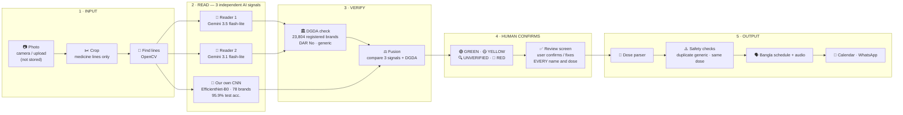

<div align="center">

# 💊 RxBondhu (রক্সবন্ধু)

### Handwritten prescription photo → verified, confirmed **Bangla medicine schedule with audio**

[](https://github.com/SJesan/RxBondhu/actions/workflows/tests.yml)
&nbsp;**[▶ Live app](https://rxbondhu.streamlit.app)** · **[📂 Code](https://github.com/SJesan/RxBondhu)** · **[🎬 Demo video](#7-live-link-demo-video-and-test-access)** · **[📊 Evaluation](docs/EVALUATION.md)** · **[📄 Project report](docs/RxBondhu_Project_Report.pdf)**

**Team Zero-Shot** · CoU AI Hackathon 2026 · Track: Healthcare & Wellbeing

</div>

> ⚠️ **Reading aid, not a doctor.** RxBondhu does not diagnose, prescribe, give dose advice or check drug interactions. **Nothing becomes a schedule until the user confirms every line.**

---

## 📌 Contents
1. [In 30 seconds](#-in-30-seconds)
2. [Team](#-team)
3. [The problem](#1-the-problem)
4. [Our solution and features](#2-our-solution-and-features)
5. [How it works — workflow](#3-how-it-works--workflow)
6. [How the AI works](#4-how-the-ai-works)
7. [Results (honest numbers)](#5-results-honest-numbers)
8. [Tech stack, models, APIs, datasets](#6-tech-stack-models-apis-datasets)
9. [Live link, demo video and test access](#7-live-link-demo-video-and-test-access)
10. [Setup and run](#8-setup-and-run)
11. [Safety, privacy and known limits](#9-safety-privacy-and-known-limits)
12. [AI tools used — disclosure](#10-ai-tools-used--disclosure)
13. [Credits and third-party assets](#11-credits-and-third-party-assets)
14. [Organiser requirements checklist](#12-organiser-requirements-checklist)

---

## ⚡ In 30 seconds

| | |
|---|---|
| **Problem** | **97.1%** of doctors in Bangladesh still write prescriptions by hand. Patients misread medicine names and doses, or take two brands of the same drug without knowing. |
| **What it does** | Photo → reads every medicine and dose → checks each name against **23,804 DGDA-registered Bangladeshi brands** → user confirms → **Bangla morning/noon/night schedule + audio**, duplicate-drug warning, calendar reminders. |
| **AI** | **Two independent Google Gemini readers** + **our own CNN** (EfficientNet-B0, trained by us on 4,680 Bangladeshi handwriting images, **95.9% test accuracy**) cross-check each other. |
| **Safety first** | In our real-photo test, **0 wrong readings were shown GREEN** and **100% of wrong readings (23/23) were flagged** for the user to check. |

---

## 👥 Team

**Team name:** Zero-Shot · **Project:** RxBondhu

| Member |
|---|
| M. Rakinul Alam |
| M. M. Sadikul Islam |
| Tanvir Mahtab Parvez Sakib |

---

## 1. The problem

In Bangladesh, **97.1% of doctors still write prescriptions by hand** (survey published in *Scientific Reports*, 2022), and many are hard to read. Patients and caregivers — especially elderly people and those who don't read English — face three real dangers:

| Danger | Example |
|---|---|
| ❌ **Wrong medicine** | A misread brand name leads to the wrong box from the pharmacy. |
| ❌ **Wrong dose / timing** | `1+0+1`, `BD`, `খাবার আগে/পরে`, `৭ দিন` are hard to understand. |
| ❌ **Double dose** | Two prescriptions contain **Napa** and **Ace** — both are Paracetamol — and the patient takes both. |

**Who benefits:** patients, family caregivers, and small pharmacies that want a quick second check.

---

## 2. Our solution and features

RxBondhu works in **three guided screens**: **① Photo → ② Check what AI read → ③ Bangla schedule.**

| # | Feature | What the user gets |
|---|---|---|
| 1 | 📷 **Photo + crop** | Upload or use the phone's rear camera; box only the medicine lines. Photos are **session-only, never stored**. |
| 2 | 🤖 **Three AI readings** | Two independent Gemini models read the photo; **our own trained CNN** checks the handwriting as a safety veto. |
| 3 | 🏛️ **DGDA verification** | Every name is checked against the official **DGDA Allopathic export** (23,804 verified brands, with DAR No, generic, strength, form). |
| 4 | 🚦 **Confidence colours** | 🟢 GREEN · 🟡 YELLOW · 🔍 UNVERIFIED · 🔴 RED — the user always knows how much to trust each line. |
| 5 | ✅ **Mandatory review** | The user confirms or corrects **every** name and dose. Closest DGDA names are offered as suggestions only — never auto-applied. |
| 6 | 💊 **Dose parser** | Understands `1+0+1`, `BD`, `TDS`, `HS`, `½`, Bangla digits and notes (`খাবার পরে`, `৭ দিন`, `চলবে`). Unclear or unusual doses are **never silently scheduled**. |
| 7 | ⚠️ **Safety warnings** | Same generic twice (e.g. Maxpro + Sergel = Esomeprazole) → duplicate warning; same dose repeated → warning. |
| 8 | 🗣️ **Bangla-first schedule + audio** | Big Bangla table with Bangla digits and one-tap **শুনুন** audio for people who can't read well. |
| 9 | 📅 **Remind & share** | Google Calendar links, repeating `.ics` file, prepared WhatsApp text (the user sends it — the app never sends anything). |
| 10 | 🗂️ **Multi-prescription mode** | 2–3 prescriptions at once; each read separately, then **cross-prescription duplicates** are flagged after confirmation. |
| 11 | ♿ **Accessible UI** | Large text by default (18px+), ≥48px buttons, light/dark themes, Bangla + English labels. |

---

## 3. How it works — workflow


<details>
<summary><b>Text version of the workflow (click to expand)</b></summary>



**Code path:** `photo → crop → segmentation.py → vlm.py (reader 1 + reader 2) + recognizer.py (CNN) → lexicon.py (DGDA) → fusion.py → review → dose_parser.py → safety.py → bangla.py / tts.py`

</details>

---

## 4. How the AI works

### Three independent signals
| Signal | What it is | Why it's there |
|---|---|---|
| **Reader 1** | Google Gemini `gemini-3.5-flash-lite` reads the whole photo (names + doses) | Reads any brand, dose and Bangla note |
| **Reader 2** | A **different** Gemini model, `gemini-3.1-flash-lite`, reads the same photo independently | One model's mistake can be caught by the other |
| **Our CNN** | EfficientNet-B0 fine-tuned **by us** on Bangladeshi doctors' handwriting | A trained, measurable model that can **veto** a reading of a brand it knows |

If a reader's model is busy, it retries once and then switches to a **backup model** — and the two readers never fall back to the same model, so they stay independent.

### How a colour is decided
| Colour | Rule | What the user is told |
|---|---|---|
| 🟢 **GREEN** | **Both** readers agree at **≥95%** match on the **same DGDA row that has a DAR No**, and our CNN does not contradict it | Looks right — still confirm |
| 🟡 **YELLOW** | Only one reader is confident, the match is fuzzy (85–94.9%), the identity is box-checked only (e.g. Napa/Ace/Fexo), or the CNN objects to a brand outside its 78 training brands | আবার দেখুন — check again |
| 🔍 **UNVERIFIED** | Readable, but **not in our DGDA snapshot** (e.g. a foreign brand) | বক্স দেখে নিশ্চিত করুন — check the box |
| 🔴 **RED** | Readers disagree, close spelling disagreement, low confidence, or our CNN confidently contradicts a brand it was trained on | ফার্মাসিস্টকে জিজ্ঞাসা করুন — ask the pharmacist |

**Fuzzy-only matches never reach GREEN.** A strong three-way agreement is shown as a signal only and never upgrades a line to GREEN by itself.

<details>
<summary><b>Our CNN — training details (click to expand)</b></summary>

| | |
|---|---|
| Model | EfficientNet-B0 (torchvision, ImageNet weights) — transfer learning |
| Data | Kaggle **Doctor's Handwritten Prescription BD** (`mamun1113`): 4,680 word images, **78 brands, 15 generics**, split 3,120 / 780 / 780 |
| Input | 128 × 384 letterboxed (word images are wide) |
| Training | Kaggle T4 GPU, 12 epochs, seed 42, augmentation (rotation, blur, brightness) |
| Result | **Validation 95.77% · Test 95.90% (748/780)** — validation ≈ test, so no sign of overfitting |
| Code & logs | [`training/train_cnn_kaggle.py`](training/train_cnn_kaggle.py) · outputs in `models/` · log in `results/kaggle_training_log.txt` |

</details>

<details>
<summary><b>DGDA reference — details (click to expand)</b></summary>

- Source: DGDA (Directorate General of Drug Administration, Bangladesh) **Allopathic Medicine Information export**, `http://180.211.137.202:9310/Allopathic/`, accessed **23 Nov 2026**.
- **41,655 source rows → 23,804 verified brand→generic entries** (with DAR No, strength, form, company). **888 conflicting identities quarantined** in `data/dgda_conflicts.csv` and never used.
- Snapshot committed as `data/dgda_brands.csv`; `data/dgda_source.json` records the sha256 and access date. **No runtime network call.**
- A local, text-only **DGDA name matcher** offers closest names as **suggestions only** — it is not an image reader and never auto-applies a name.
- "DGDA-registered" is an **identity check only** — not dose advice and not a medical approval. A name missing from the export is **UNVERIFIED, never "not approved"**. Allopathic only — we do not claim "all Bangladeshi medicines".

</details>

---

## 5. Results (honest numbers)

| Measure | Result | What it means |
|---|---|---|
| 🧠 Our CNN — **word-crop test accuracy** | **95.9% (748/780)** | Clean single-word images, held-out test split. Not whole-photo accuracy. |
| 🛡️ **Unsafe GREEN** (wrong name shown GREEN) | **0** (0/14) | No wrong reading was ever shown as safe. |
| 🛡️ **Catch rate** (wrong readings flagged) | **100% (23/23)** | Every wrong reading was flagged, never GREEN. |
| Reader 1 — names correct | 57.4% (27/47) | Real handwritten photos |
| Reader 2 — names correct | 68.1% (32/47) | Real handwritten photos |
| Combined — names shown correct, before human correction | 51.1% (24/47) | Real handwritten photos |
| Dose notation correct | 16.7% (8/48) | Why human confirmation of doses is **mandatory** |
| Over-flag (correct name shown RED) | 12.5% (3/24) | Conservative by design |
| Our CNN on the same real photos | 0/47 | Those brands were outside its 78 training classes — the CNN acts as a safety veto, not the main reader |

**Method:** 10 real handwritten prescriptions (48 lines) from one writer. Dev rows 1–5 were used to choose the candidate threshold; results were reported once on holdout rows 6–10. `GREEN ≥ 95` is a fixed safety policy, not a tuned number. Gemini output varies slightly between runs; numbers come from the committed cache run. These real-photo results were measured **before the 24 Nov update** that limits the CNN veto to its 78 trained brands (that update turns some REDs into YELLOW; GREEN rules are unchanged).

**Takeaway:** reading messy handwriting is still hard, so we designed RxBondhu to **never hide its mistakes** — it flags them and asks the user to confirm.

Full logs and before/after comparisons: [`docs/EVALUATION.md`](docs/EVALUATION.md) · `results/handwritten_boxcap_*`.

---

## 6. Tech stack, models, APIs, datasets

| Layer | Technology |
|---|---|
| Language | Python 3.11 |
| App / UI | Streamlit, streamlit-cropper, Three.js (bundled locally for the capsule animation) |
| Vision & matching | OpenCV, NumPy, Pillow, RapidFuzz |
| Our model | PyTorch + torchvision **EfficientNet-B0**, fine-tuned by us |
| AI readers (API) | **Google Gemini** via Google AI Studio — `gemini-3.5-flash-lite`, `gemini-3.1-flash-lite`; backups `gemini-2.5-flash`, `gemini-flash-latest` |
| Speech | `facebook/mms-tts-ben` (Hugging Face, CC-BY-NC-4.0), gTTS fallback |
| Reference data | DGDA Allopathic Medicine Information export (23 Nov 2026) |
| Training data | Kaggle **Doctor's Handwritten Prescription BD** (`mamun1113`) |
| Training / hosting | Kaggle T4 GPU · GitHub + GitHub Actions (CI) · Streamlit Community Cloud |
| Evaluated, **not shipped** | Groq `qwen/qwen3.8-27b` (failed our 30% accuracy / 10 s gate) · our own RxFusion char-CNN experiment · Kaggle/MedEx "Assorted Medicine Dataset of Bangladesh" (superseded by DGDA) |

---

## 7. Live link, demo video and test access

| | |
|---|---|
| 🌐 **Live app** | **https://rxbondhu.streamlit.app** (Streamlit Community Cloud, free tier — see [`docs/DEPLOY.md`](docs/DEPLOY.md)) |
| 📂 **Public code** | **https://github.com/SJesan/RxBondhu** |
| 🎬 **Demo video** (≤3 min, backup) | `<ADD VIDEO LINK HERE>` |
| 🔑 **Test credentials** | **Not needed** — the app has no login. |

The live app shows **six click-to-use demo prescriptions** (`assets/demo/`). They are computer-generated, fictional and labelled "DEMO ONLY" — use them to try the app quickly; our evaluation used real handwritten prescriptions.

---

## 8. Setup and run

```bash
git clone https://github.com/SJesan/RxBondhu.git
cd RxBondhu
python -m venv venv
venv\Scripts\activate              # Mac/Linux: source venv/bin/activate
pip install -r requirements.txt
copy .env.example .env             # Mac/Linux: cp .env.example .env
#   → open .env and paste your own GEMINI_API_KEY (never commit .env)
streamlit run app.py
```

- **Gemini key:** free from [Google AI Studio](https://aistudio.google.com/apikey). On Streamlit Cloud, put it in **Secrets** (see `.streamlit/secrets.toml.example`).
- **Without a Gemini key** the app still runs (CNN-only, nothing becomes GREEN). **Without the CNN file** it runs with the readers only.
- `GROQ_API_KEY` in `.env.example` is a placeholder from the bake-off only — the app never calls Groq.

### Tests
```bash
python -m unittest discover -s tests -q
```
**159 automated tests** — they also run automatically on every push (GitHub Actions badge at the top).

<details>
<summary><b>Re-run the evaluations (click to expand)</b></summary>

Real-handwriting evaluation (needs your own answer key + photos; never invents results):
```bash
python tools\evaluate_handwritten.py --answers results\answer_key.csv --images results\rx --cache results\vlm_cache.jsonl --out results\handwritten_boxcap_log.csv --summary results\handwritten_boxcap_summary.json
```
Reports name accuracy (CNN / reader 1 / reader 2 / combined), dose accuracy, unsafe-GREEN, catch and over-flag rates. Template: [`results/answer_key_template.csv`](results/answer_key_template.csv). Answer keys and photos stay private (gitignored); only derived metrics are committed.

Line-localization check on 200 public handwritten prescriptions (positions only, not name accuracy):
```bash
python tools\evaluate_localization.py --zip "<dataset.zip>"
```

Retrain the CNN on Kaggle: GPU T4 + Internet On → add the dataset as Input → run `training/train_cnn_kaggle.py` (seed 42). Outputs `rx_cnn.pt`, `labels.json`, `test_report.csv`, `training_summary.txt` go in `models/`.

</details>

<details>
<summary><b>Project structure (click to expand)</b></summary>

```
app.py                      Streamlit app — 3 guided screens
rxbondhu/
  segmentation.py           find handwritten lines and words (OpenCV)
  vlm.py                    Gemini readers (retry + backup models)
  recognizer.py             our trained CNN
  lexicon.py                DGDA lookup + fuzzy suggestions
  fusion.py                 combine 3 signals → GREEN / YELLOW / UNVERIFIED / RED
  dose_parser.py            1+0+1, BD, TDS, HS, Bangla notes → schedule
  safety.py                 duplicate-generic and same-dose warnings
  bangla.py, tts.py         Bangla text and audio
  multi.py                  multi-prescription mode
  reminders.py, sharing.py  calendar / .ics / WhatsApp text
  ui.py, camera.py          interface and rear camera
models/                     rx_cnn.pt, labels.json, training outputs
data/                       DGDA snapshot, conflicts, source record
training/                   Kaggle training script
tools/                      evaluation and demo-image tools
tests/                      159 automated tests
docs/                       evaluation, demo script, deploy guide, project report
```

</details>

---

## 9. Safety, privacy and known limits

### Safety by design
- **Human confirmation is mandatory** — nothing becomes a schedule until the user confirms every name and dose.
- **GREEN is strict** — two independent readers + a DGDA row with a DAR No. Fuzzy-only is never GREEN.
- **RED and UNVERIFIED tell the user what to do**: `ফার্মাসিস্টকে জিজ্ঞাসা করুন` / `বক্স দেখে নিশ্চিত করুন`.
- **Unclear or unusual doses are never silently scheduled.**
- Identity cards say **"identity only, not dose advice"** — no approvals, prices, indications or clock times are claimed.
- **No output is hard-coded or faked** — every reading comes from the real models.

### Privacy
- Photos are processed in the session only and **never stored**. They are sent to Google Gemini for reading.
- Our test prescriptions were written by team members/volunteers — **no real patient data** is in this repository.
- API keys live only in `.env` / Streamlit Secrets, both excluded from Git.

### Known limits (honest)
- Real-photo test: **10 prescriptions from one writer** — a safety check, not a population-level accuracy claim.
- **95.9% is word-crop accuracy**, not whole-photo accuracy; the CNN knows only 78 brands.
- Dose reading from handwriting is weak (16.7%) — hence mandatory confirmation.
- Gemini free tier can be busy; the app retries and uses backup models, but a busy service can cap lines at YELLOW.
- DGDA snapshot is Allopathic only; a missing name is UNVERIFIED, never a regulatory judgement.
- No interaction database, no dose advice, **no clinical validation yet**.

### Next steps
1. Pilot with 2–3 pharmacies, compared against pharmacist reading.
2. Collect multi-writer handwriting (with consent) to grow the CNN beyond 78 brands.
3. Improve dose reading; offline mode; clinical validation before any real-world use.

---

## 10. AI tools used — disclosure

As required by the hackathon rules, every AI tool, model and API is listed here.

| Tool | Type | Used for |
|---|---|---|
| **Claude (Anthropic, via claude.ai)** | AI coding assistant | Idea selection and the Phase-1 idea document; project plan and roadmap; the first version of the code (Kaggle training script, word/line segmentation, two-model fusion and confidence colours, dose parser, Bangla text and speech, Streamlit app); debugging real-photo tests; the test-prescription sheet; a pre-submission code review and fixes (reader retry/backup, CNN-veto scope, missing imports); presentation and Q&A preparation; this README. |
| **OpenCode (Big Pickle)** | AI coding agent | Rebuilding and extending the app (DGDA matching, multi-prescription mode, UI, camera, sharing), debugging, tests and project docs. |
| **Google Gemini** (`gemini-3.5-flash-lite`, `gemini-3.1-flash-lite`, backups `gemini-2.5-flash`, `gemini-flash-latest`) | In-app AI model (API) | The two photo readers. |
| **Our EfficientNet-B0 CNN** | Our own trained model | Handwriting safety veto and proof of an own model. |
| **facebook/mms-tts-ben**, **gTTS** | Speech models | Bangla audio. |
| **Groq `qwen/qwen3.8-27b`** | Model (API) | 10-image bake-off only — **not shipped**, no key needed. |

The team chose the problem, designed the safety rules, trained and evaluated the model, wrote the test prescriptions and made every product decision.

---

## 11. Credits and third-party assets

- **Doctor's Handwritten Prescription BD dataset** — Kaggle user `mamun1113` (CNN training and test). All credit to the dataset authors.
- **DGDA Allopathic Medicine Information export** — Directorate General of Drug Administration, Bangladesh (identity reference).
- **EfficientNet-B0 / torchvision** (BSD-3-Clause; ImageNet weights) · **facebook/mms-tts-ben** (CC-BY-NC-4.0) · **gTTS** (MIT) · **Three.js** (MIT, bundled locally) · Streamlit, OpenCV, RapidFuzz, PyTorch, NumPy, Pillow, pandas and other libraries under their own open-source licences.
- **Google Gemini API** — Google API terms; each user brings their own key.

Full list with licences: [`RESOURCES.md`](RESOURCES.md).

---

## 12. Organiser requirements checklist

| Requirement (rule book) | Where |
|---|---|
| Project, team and member names | [Team](#-team) |
| Problem and solution summary | [§1](#1-the-problem), [§2](#2-our-solution-and-features) |
| Features and how the AI works | [§2](#2-our-solution-and-features), [§3](#3-how-it-works--workflow), [§4](#4-how-the-ai-works) |
| Tech stack, models, APIs, datasets | [§6](#6-tech-stack-models-apis-datasets) |
| AI tools used and for what | [§10](#10-ai-tools-used--disclosure) |
| Third-party code and assets credited | [§11](#11-credits-and-third-party-assets), [`RESOURCES.md`](RESOURCES.md) |
| Setup steps | [§8](#8-setup-and-run) |
| Live link and demo video | [§7](#7-live-link-demo-video-and-test-access) |
| Test credentials (if login) | Not needed — no login |
| Real AI only, nothing hard-coded | [§9](#9-safety-privacy-and-known-limits) |
| No keys in the repo; `.env.example` provided | `.env` and `secrets.toml` are gitignored; [`.env.example`](.env.example) |

---

<div align="center">

**RxBondhu — হাতের লেখা প্রেসক্রিপশনের বিশ্বস্ত বন্ধু**
*Made with care by Team Zero-Shot for CoU AI Hackathon 2026*

</div>
